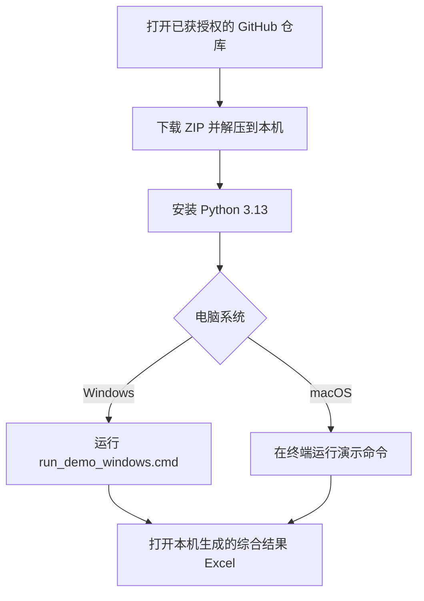
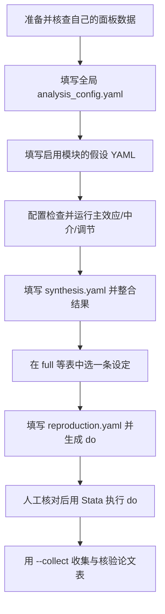

# auto-stata 

**面板数据实证回归基准检验工具**

auto-stata 是在自己电脑上运行的 Python 项目：研究者用 YAML 写明数据、变量与假设，程序批量完成基准检验、整理候选设定，并生成供 Stata 核验的 do 文件。它适合想系统尝试面板回归、但不想从零编写整套脚本的商科同学。
## 项目简介

| 目前能做什么 | 你会得到什么 |
| --- | --- |
| 主效应：线性、U 型和倒 U 型初筛 |  `full`、`strong`、`weak` 等结果表 |
| 中介效应：两步法或三步法 |  `full`、`strong`、`weak` 等结果表 |
| 调节效应：线性、U 型和倒 U 型初筛 |   `full`、`strong`、`weak` 等结果表|
| 结果整合：按共同设定和假设门槛筛选 | `full`、`require`、`strong`、`weak` 等工作表 |
| 结果复现：选一条设定生成 do 文件 | 精确版、初学者简明版；执行并收集后可整理论文表 |

第一次使用建议先跑**合成演示数据**，确认环境能工作，再换成自己的数据。仓库另含获授权的测试数据，使用范围见[数据说明](DATA_NOTICE.md)。演示不需要 Stata；真正执行复现 do 文件需要另行安装有使用权的 Stata。

## 安装与使用：30 秒看懂路线



1. **下载项目。** 在仓库页面点 **Code → Download ZIP**，解压后进入含 `README.md` 和 `requirements.txt` 的项目文件夹。也可以用 GitHub Desktop 克隆。下载 ZIP 只是复制一份到电脑，修改本地文件不会自动传回 GitHub。[GitHub 下载说明](https://docs.github.com/en/repositories/working-with-files/using-files/downloading-files-from-github)
2. **安装 Python。** 新用户建议安装 [Python 3.13.17 官方安装包](https://www.python.org/downloads/release/python-31317/)：Windows 选择 **Windows installer (64-bit)**，保留 Python Launcher；macOS 选择 **macOS installer**。项目已测试 Python 3.10–3.13，已有这些版本可以先用，不必为演示重复安装。Windows 在命令提示符输入 `py -3.13 --version`、macOS 在终端输入 `python3.13 --version`，能显示版本号才进入下一步。
3. **选编辑器，可跳过。** 推荐 [VS Code](https://code.visualstudio.com/download) 来打开整个项目文件夹、编辑 YAML 和查看结果，但它**不是必装软件**。Windows 可用系统“记事本”；macOS 可用“文本编辑”，先切换为纯文本并保留 `.yaml` 扩展名。不要用 Word 编辑配置文件。
4. **运行演示。** 首次安装依赖需要联网，运行完成后查看终端提示的输出目录。后续可直接配置在本地无需联网使用

**Windows 10/11：** 在解压后的项目文件夹中双击 `run_demo_windows.cmd`。如果窗口报 Python 未找到，先重开命令提示符检查 `py -3.13 --version`；如果已有其他受支持版本，脚本也会尝试使用。Windows 对未知下载脚本可能弹出安全提示，请先确认来源并查看脚本内容，不要绕过学校或电脑的安全规定。

**macOS：** 打开“终端”，输入 `cd `（后面有一个空格），把项目文件夹从 Finder 拖入终端，再按回车。随后逐行执行：

```bash
python3.13 -m venv .venv
.venv/bin/python -m pip install -r requirements.txt
.venv/bin/python scripts/run_demo.py
```

完成后到 `回归结果解读/基准检验/output/公开演示/2018-2023（纯合成演示）/result_synthesis/` 打开 `综合结果总览.xlsx` 或 `merged_full_results.xlsx`。严格筛选的工作表为空不一定是故障，先看 `full` 和“假设明细”。

### 配置保存在哪里

程序、配置、输入数据和默认输出都在你解压/克隆的本机文件夹中。VS Code 只是可选的本地编辑界面；GitHub 网页也不是运行环境。只有你主动提交、推送或上传文件时，内容才会进入远程仓库。请勿把真实研究数据、令牌和个人路径提交到公开仓库。

## 怎么使用自己的数据

先看各文件的分工：

| 位置 | 用途 |
| --- | --- |
| `回归结果解读/基准检验/data/` | 放本地数据；支持 `.dta`、`.csv`、`.xlsx`，也可在全局 YAML 指向别处 |
| `回归结果解读/基准检验/config/analysis_config.yaml` | 公共数据路径、样本标签、面板列、控制变量、预处理和运行开关 |
| `回归结果解读/基准检验/skill/main_effect/main.yaml` | 主效应变量关系与假设 |
| `回归结果解读/基准检验/skill/mediation_effect/mediation.yaml` | 中介效应变量关系与假设 |
| `回归结果解读/基准检验/skill/moderation_effect/moderation.yaml` | 调节效应变量关系与假设 |
| `回归结果解读/基准检验/skill/result_synthesis/synthesis.yaml` | 本轮综合的假设和通过门槛 |
| `回归结果解读/结果复现/reproduction.yaml` | 指定一条结果设定，生成 do 文件 |
| `回归结果解读/基准检验/output/`、`回归结果输出/` | 回归、整合、复现与论文表输出 |

文件类型也有分工：`.md` 是使用说明；`.yaml` 是需要按研究方案修改的配置；`.py` 是运行程序；`.do` 是交给 Stata 执行的命令；`.xlsx` 是结果表。通常先改 YAML，再运行相应 Python，不必修改 Python 源码。



1. **准备数据。** 先按研究设计筛好年份、行业、ST 等样本，检查企业-年份是否唯一、变量口径和缺失情况，保留原始数据与筛选记录。全局 YAML 的 `sample_period`、`sample_rules` **只是标签，不会自动筛选样本**。
2. **填公共配置。** 在 [全局配置](回归结果解读/基准检验/config/analysis_config.yaml) 中设置 `data.input_file`（相对路径从“基准检验”目录算起）、面板列名、控制变量及处理方案；把 `project.name` 改成自己的项目名。变量名必须与数据列名一致。只启用实际需要的模块。
3. **填假设。** 分别在[主效应](回归结果解读/基准检验/skill/main_effect/main.yaml)、[中介效应](回归结果解读/基准检验/skill/mediation_effect/mediation.yaml)、[调节效应](回归结果解读/基准检验/skill/moderation_effect/moderation.yaml) YAML 中配置本研究的关系；没做的模块不必强行运行。先读[全局说明](回归结果解读/基准检验/全局.md)和各模块同目录说明文件。
4. **检查并运行回归。** 在项目根目录的命令提示符/终端中，依次运行下面命令。Windows 先在资源管理器打开项目文件夹，在地址栏输入 `cmd` 回车；macOS 使用上面进入项目目录的方法。只运行全局 YAML 中启用的模块；若禁用某模块，也把下方相应命令略去。

Windows：

```bat
.venv\Scripts\python.exe "回归结果解读\基准检验\skill\other\config_validation.py" "回归结果解读\基准检验\config\analysis_config.yaml"
.venv\Scripts\python.exe "回归结果解读\基准检验\skill\main_effect\run_main_effect.py"
.venv\Scripts\python.exe "回归结果解读\基准检验\skill\mediation_effect\run_mediation_effect.py"
.venv\Scripts\python.exe "回归结果解读\基准检验\skill\moderation_effect\run_moderation_effect.py"
```

macOS：

```bash
.venv/bin/python "回归结果解读/基准检验/skill/other/config_validation.py" "回归结果解读/基准检验/config/analysis_config.yaml"
.venv/bin/python "回归结果解读/基准检验/skill/main_effect/run_main_effect.py"
.venv/bin/python "回归结果解读/基准检验/skill/mediation_effect/run_mediation_effect.py"
.venv/bin/python "回归结果解读/基准检验/skill/moderation_effect/run_moderation_effect.py"
```

5. **整合结果。** 在 [synthesis.yaml](回归结果解读/基准检验/skill/result_synthesis/synthesis.yaml) 登记本轮纳入的假设与要求；完成本轮启用的回归后，运行：

```text
Windows: .venv\Scripts\python.exe "回归结果解读\基准检验\skill\result_synthesis\run_result_synthesis.py" "回归结果解读\基准检验\config\analysis_config.yaml"
macOS:   .venv/bin/python "回归结果解读/基准检验/skill/result_synthesis/run_result_synthesis.py" "回归结果解读/基准检验/config/analysis_config.yaml"
```

输出在当前项目、样本目录下的 `result_synthesis/`。从 `综合结果总览.xlsx` 或 `merged_full_results.xlsx` 查看设定，不要只看“通过”字样。

6. **选择一条设定生成复现文件。** 在 [reproduction.yaml](回归结果解读/结果复现/reproduction.yaml) 把 `source.synthesis_file` 指向本轮 `result_synthesis/merged_full_results.xlsx`；从同一行复制 `run_id` 和 `specification_id` 到 `selection`。运行 `run_reproduction.py`。它只生成 `exact.do` 和/或 `beginner.do`，**不会替你运行 Stata**。
7. **执行并核对。** 先检查生成的 do 文件中的路径、样本与变量，再用有使用权的 [Stata](https://www.stata.com/install-guide/) 执行**整份** do 文件。简明版还需安装 `winsor2`、`reghdfe` 等 Stata 扩展；`esttab` 可选，用于 RTF 表。精确版与简明版处理口径不完全相同，不要把两版结果混成同一张历史复现表。
8. **收集实际估计结果。** Stata 完成后，在项目根目录运行下方收集命令，核对日志、系数和表格，再判断能否用于论文；未执行 do 文件不能凭筛选标签生成真实论文回归表。

```text
Windows: .venv\Scripts\python.exe "回归结果解读\结果复现\run_reproduction.py" --collect
macOS:   .venv/bin/python "回归结果解读/结果复现/run_reproduction.py" --collect
```

生成 do 的命令与上面相同，只需去掉 `--collect`。更详细的配置和输出说明见[全局说明](回归结果解读/基准检验/全局.md)与[结果复现说明](回归结果解读/结果复现/复现SKILL.md)。

## 结果怎么读

| 工作表 | 含义 |
| --- | --- |
| `full` | 本轮已执行的公共设定；失败、未通过和缺少 C 阶段结果也保留 |
| `require` | 满足用户在 synthesis 中逐假设设置的 `required_pass` 门槛 |
| `strong` | 本轮纳入的全部假设均强通过 |
| `weak` | 本轮纳入的全部假设至少弱通过；强通过也算在内 |
| `假设明细`、`字段说明` | 查看逐假设状态及字段定义 |

`require`、`strong`、`weak` 为空时，先在 `full` 和“假设明细”检查失败、缺少 C 结果或门槛设置。精确版 do 只复现选定设定下**已有 C 结果**的模型；简明版可把缺少 C 的已启用假设作为新增复测，不能把它说成历史模型。不同模型的最终样本也可能不同。**候选模型、强通过、弱通过都是程序筛选标签，不等于经济学意义上的因果证明、论文检验已通过，或 Stata 已完成复现。**论文表只能使用实际执行并核对后的估计结果。

## 边界与路线图

- 当前针对 **U 型/倒 U 型** 的判定只用于初筛。研究者仍需检查拐点是否在实际观测区间内，并结合斜率、合适的专门检验与理论解释，不能仅凭标签断言 U 型成立。
- 中介模块提供路径回归的候选证据，**尚不等于 Bootstrap 间接效应确认**；对识别假设、置信区间和因果解释仍需独立核查。
- 生成的 do 文件必须人工检查数据路径、样本筛选、变量定义、预处理、固定效应、聚类标准误和实际运行日志。简明版使用常见 Stata 命令帮助学习，可能与 Python 精确口径有数值差异。
- 当前不自动下载研究变量，也不代替变量构造、稳健性检验、内生性处理或论文写作。后续计划逐步补齐数据下载与变量构造、Bootstrap 间接效应确认、稳健性/内生性模块，并最终探索**零代码网页端**，让使用流程更简单；
## 反馈与项目

欢迎按文档独立试用合成演示，并通过仓库 [Issues](https://github.com/18810336759/AutoStata-Empirical-Traversal-Tool/issues) 反馈操作步骤、报错截图和预期结果；请先删除截图或日志中的真实数据、个人路径与密钥。若仓库仍为 Private，只有获授权账号可提交 Issue；无法访问时请联系仓库维护者。安全问题请先看 [SECURITY.md](SECURITY.md)，贡献方式见 [CONTRIBUTING.md](CONTRIBUTING.md)。

项目采用 [AGPL-3.0 许可证](LICENSE)。项目获得**吉林大学 OPC 课题（2026OPC016）**资助。演示与测试数据的使用说明见 [DATA_NOTICE.md](DATA_NOTICE.md)，公开发布前的核查事项见[检查表](RELEASE_CHECKLIST.md)。进一步阅读：[基准检验手册](回归结果解读/基准检验/全局.md)、[结果整合说明](回归结果解读/基准检验/skill/result_synthesis/result_synthesis.md)、[复现说明](回归结果解读/结果复现/复现SKILL.md)。有关统计方法和代码口径，以各模块说明文档、配置和实际运行输出为准；欢迎关注后续版本，但请以当前已发布功能为准。
